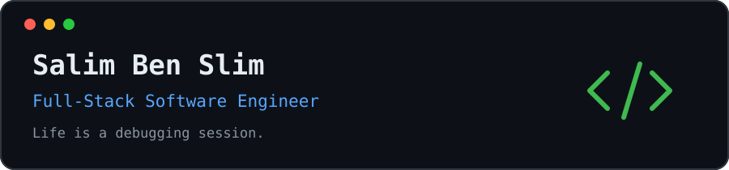

<div align="center">



**Life is a debugging session.**

Building real products · Tracing unexpected behavior · Learning how systems work

</div>

---

### `> whoami`

I'm a full-stack developer based in **Tunisia**. I build web applications and SaaS products, from the interface to the backend and deployment.

What keeps me curious is the part you don't always see: **why a system behaves the way it does**, especially when something breaks.

- 🛠️ **Building:** Full-stack applications, APIs, and real-time experiences.
- 🔍 **Investigating:** Node.js internals, async execution, HTTP, and security.
- 🧠 **Thinking about:** System design, reliability, performance, and debugging.
- 🎯 **My approach:** Reproduce → Trace → Understand → Fix → Verify.

### `> tech --stack`

<div align="center">

**Languages**

<p><strong>TypeScript · JavaScript · Python · C++</strong></p>

**Frontend**

<p><strong>React · Next.js · Tailwind CSS · HTML · CSS</strong></p>

**Backend & Data**

<p><strong>Node.js · Express · PostgreSQL · MongoDB · MySQL · Redis</strong></p>

**Infrastructure & Tools**

<p><strong>Docker · AWS · Nginx · Git · GitHub · GitHub Actions · Linux</strong></p>

</div>

### `> experience --highlights`

<table>
<tr>
<td width="50%" valign="top">

**☕ CoffAI — Café SaaS**

Built and deployed a café management platform with ordering workflows, role-based access, real-time updates, and station-based printing.

`React` `Node.js` `PostgreSQL` `Socket.IO`

</td>
<td width="50%" valign="top">

**⚙️ Full-Stack Product Engineering**

Worked on production web applications spanning frontend interfaces, backend APIs, authentication, database workflows, and deployments.

`Next.js` `Express` `MongoDB` `AWS`

</td>
</tr>
</table>

> Some of my professional work is in private repositories. I share independent experiments and public projects as they become ready.

### `> interests --deep-dive`

| Building systems | Understanding systems |
| :--- | :--- |
| SaaS applications and APIs | Node.js event loop and async behavior |
| Real-time features | Error propagation and observability |
| Authentication and authorization | HTTP parsing and application security |
| Database-backed workflows | Performance and scalability trade-offs |

### `> github --activity`

Explore my [public repositories](https://github.com/salimBenSlim1?tab=repositories) and [contribution history](https://github.com/salimBenSlim1?tab=overview).

<div align="center">


</div>

<details>
<summary><b>How I approach debugging</b></summary>
<br />

```text
Observe the symptoms
    ↓
Reproduce the problem
    ↓
Trace the execution path
    ↓
Explain the root cause
    ↓
Fix the behavior
    ↓
Verify the assumptions
```

A passing test tells me something works under the tested conditions. Understanding the execution path helps me reason about what happens outside them.

</details>

---

<div align="center">

### Build. Debug. Understand. Improve.

<sub>Thanks for stopping by — feel free to explore my repositories.</sub>

</div>
